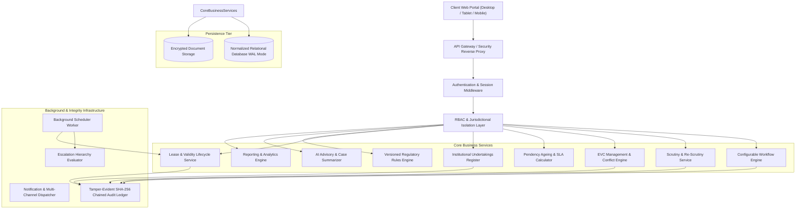

# SYSTEM ARCHITECTURE SPECIFICATION
## AICTE Smart Approval & Compliance Management System
**Problem Statement ID:** 26262 | **Organization:** All India Council for Technical Education (AICTE)  
**Bureau:** Regulation Bureau | **Classification:** Enterprise Government Workflow Automation

---

## 1. Architectural Philosophy & Strategy
The AICTE Smart Approval & Compliance Management Platform is engineered as a high-integrity, modular digital governance architecture designed specifically for regulatory rigor, statutory accountability, and national-scale reliability.

### Key Architectural Tenets:
1. **Statutory Non-Delegation Principle:** The platform preserves human authority over all statutory decisions (grants, rejections, regulatory penalties). AI and automation serve purely as assistive and analytical layers.
2. **Version-Controlled Regulatory Determinism:** Workflow paths, SLA calculation methods, document mandates, and approval hierarchies are bound to specific Approval Process Handbook (APH) regulatory versions and Academic Sessions.
3. **Cryptographic Tamper-Evidence:** Every administrative action is written to an immutable append-only ledger chained via SHA-256 cryptographic hashes, guaranteeing non-repudiation and enabling audit verification by statutory oversight bodies (CAG, CVC).
4. **Zero-Trust Role & Jurisdictional Isolation:** Attribute-Based Access Control (ABAC) and Role-Based Access Control (RBAC) enforce strict data partitioning preventing cross-regional and cross-institutional leakage.

---

## 2. Component Specifications
- **Application Runtime:** Node.js 24 LTS / Spring Boot 3 Java 21 LTS modular enterprise framework.
- **Persistence:** Relational schema supporting SQLite (embedded zero-config) and PostgreSQL (distributed production) with Write-Ahead Logging (WAL) and foreign key enforcement.
- **Cryptographic Engine:** Salted Scrypt password derivation, HMAC-SHA256 signed bearer tokens, SHA-256 chained blockchain-style audit hashing.
- **Background Scheduler:** Asynchronous daemon polling application SLA deadlines, expiring leases (at 90, 60, 30, 15, and 7-day windows), and overdue undertakings.
