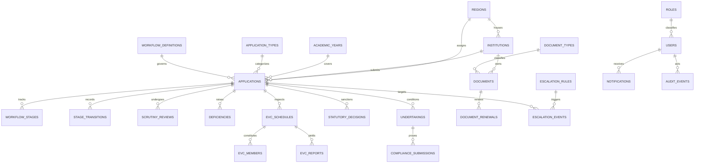

# DATABASE SCHEMA & ENTITY RELATIONSHIP SPECIFICATION
## AICTE Smart Approval & Compliance Management System

---

## 1. Relational Entity Overview
The database schema is fully normalized into 27 relational tables with strict foreign key integrity, check constraints, and performance indexes.

---

## 2. Core Tables Dictionary

| Table Name | Primary Key | Key Foreign Keys | Purpose |
|---|---|---|---|
| `users` | `id` | `role_code`, `region_id` | Authentication and user identity with salted Scrypt hash |
| `institutions` | `id` | `region_id`, `rep_id` | Master institution profile (PID, category, type) |
| `applications` | `id` | `institution_id`, `wf_id` | Core approval lifecycle application master record |
| `workflow_stages` | `id` | `application_id` | Stage-level entry, SLA due date, and completion status |
| `stage_transitions` | `id` | `application_id`, `actor_id` | Immutable transition log of workflow movements |
| `scrutiny_reviews` | `id` | `application_id`, `officer_id` | Formal scrutiny outcome and digital signature hash |
| `deficiencies` | `id` | `application_id`, `review_id` | Deficiency entries with APH regulatory references |
| `evc_schedules` | `id` | `application_id`, `coord_id` | Inspection visit dates and scheduling status |
| `evc_members` | `id` | `evc_schedule_id` | Assigned committee members with conflict checks |
| `evc_reports` | `id` | `evc_schedule_id` | Quantitative scores and formal inspection findings |
| `undertakings` | `id` | `institution_id`, `app_id` | Time-bound compliance register with unique UTK ID |
| `compliance_submissions`| `id` | `undertaking_id` | Evidence submissions (submission != compliance!) |
| `documents` | `id` | `institution_id`, `doc_type` | Land lease and safety deeds with expiry dates |
| `document_renewals` | `id` | `document_id` | Renewal applications pending officer verification |
| `notifications` | `id` | `recipient_user_id` | Multi-channel event alert register |
| `escalation_events` | `id` | `application_id`, `rule_id`| SLA breach escalations dispatched up the hierarchy |
| `regulatory_rule_sets`| `id` | None | Versioned APH rule drafts and published regulations |
| `audit_events` | `id` (Auto) | None | Cryptographic SHA-256 chained audit blockchain ledger |
