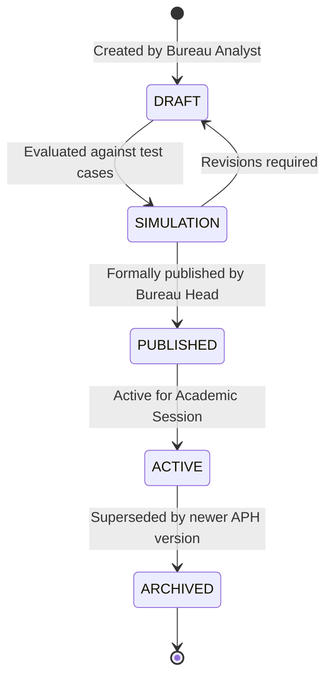

# REGULATORY RULES ENGINE & APH CONFIGURATION GUIDE
## AICTE Smart Approval & Compliance Management System

---

## 1. Overview
The AICTE regulatory framework changes across Academic Years and official Approval Process Handbook (APH) releases. Universal hardcoding of deadlines, document mandates, or stage sequences is strictly prohibited. The system implements a **Version-Controlled Regulatory Rules Engine**.

## 2. Rule Lifecycle: Draft to Publication
To ensure administrative safety and legal non-repudiation:
1. **DRAFT Status:** Any regulatory rule change (e.g., minimum land requirement, faculty cadre ratio tolerance, SLA days) is created in `DRAFT` status by an authorized analyst or bureau user.
2. **Review & Simulation:** Draft rules are evaluated against historical application batches.
3. **Formal Publication:** Only users with `REGULATION_BUREAU_ADMIN` or `SUPER_ADMIN` privileges can formally publish and activate a regulatory rule set. Once published, the rule is immutably timestamped, digitally signed, and logged to the cryptographic audit trail.

## 3. Supported Configuration Dimensions
- **Academic Year:** `2026-2027`, `2025-2026`, etc.
- **APH Version:** `APH-2026-v1.0`, `APH-2026-v2.0-AMEND`.
- **Application Category:** New Technical Institution, Extension of Approval (EoA), Increase in Intake, Closure.
- **Institution Type:** Government, Private-Unaided, Deemed to be University, Central University.
- **Permitted Workflow Transitions:** Matrix defining allowable hops (e.g. Scrutiny → EVC vs Scrutiny → Re-Scrutiny).
- **Stage SLAs:** Target days per stage (e.g. Scrutiny: 7 days, EVC: 14 days, Decision: 7 days).
- **Advance Reminder Windows:** 90, 60, 30, 15, and 7 days for document expirations.

Where an AICTE regulation or deadline is not officially published or verified, the system explicitly marks it as **`Configuration Required`** rather than inventing statutory parameters.
